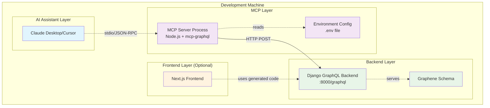
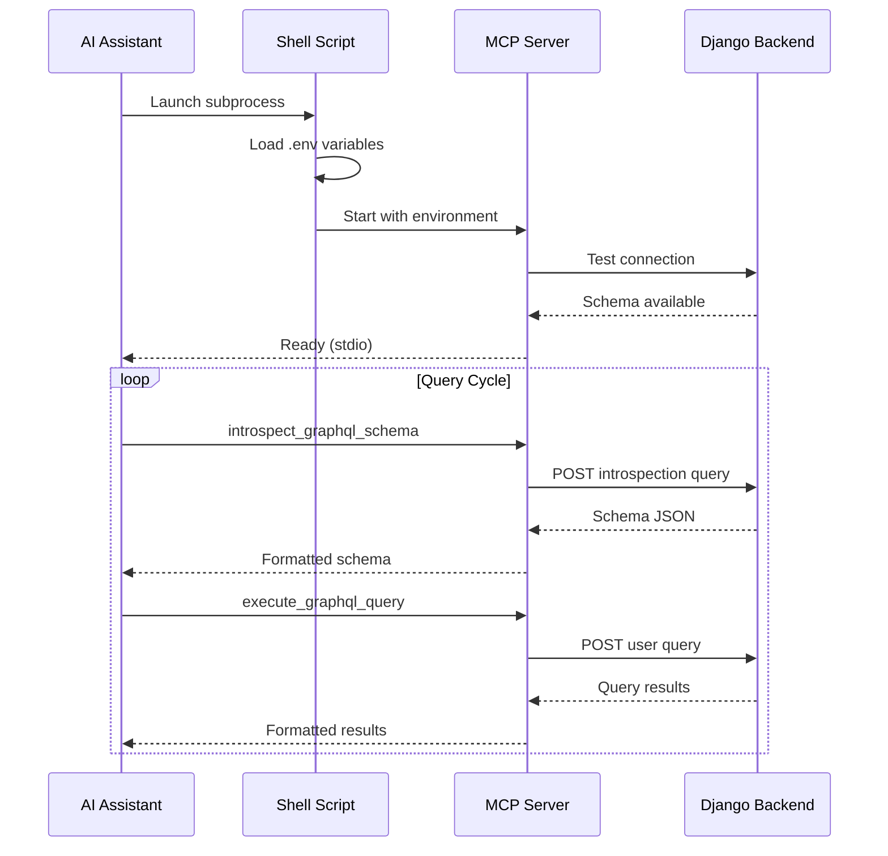

# Design Document

## Overview

The Django GraphQL MCP Server is a Node.js-based Model Context Protocol server that bridges Django GraphQL backends with AI assistants like Claude Desktop and Cursor. The system provides two core capabilities: GraphQL schema introspection and query execution, enabling AI assistants to understand and interact with Django GraphQL APIs in real-time.

The server operates as a standalone process using the MCP stdio transport, making it compatible with existing MCP clients while maintaining security through local-only operation and configurable mutation controls.

## Architecture

### System Architecture



### Transport Layer

The system uses MCP's stdio transport for client-server communication:

- **Protocol**: JSON-RPC over stdio (standard input/output)
- **Message Format**: Newline-delimited JSON messages
- **Client Role**: AI assistant (Claude/Cursor) launches MCP server as subprocess
- **Server Role**: MCP server reads from stdin, writes to stdout
- **Session Management**: Stateless operation with per-request authentication

### Process Architecture



## Components and Interfaces

### MCP Server Core

**Responsibilities:**

- MCP protocol implementation (stdio transport)
- Tool registration and execution
- Environment configuration management
- Error handling and logging

**Key Dependencies:**

- `mcp-graphql` npm package (primary implementation)
- `dotenv` for environment variable loading
- Node.js 18+ runtime

### GraphQL Interface Component

**Responsibilities:**

- HTTP client for Django GraphQL endpoint
- Authentication header management
- Request/response transformation
- Connection pooling and error recovery

**Interface Definition:**

```typescript
interface GraphQLClient {
  endpoint: string;
  headers: Record<string, string>;

  introspect(): Promise<IntrospectionResult>;
  execute(query: string, variables?: any): Promise<GraphQLResponse>;
}

interface IntrospectionResult {
  data: {
    __schema: {
      types: GraphQLType[];
      queryType: GraphQLType;
      mutationType?: GraphQLType;
      subscriptionType?: GraphQLType;
    };
  };
}

interface GraphQLResponse {
  data?: any;
  errors?: GraphQLError[];
}
```

### Configuration Manager

**Responsibilities:**

- Environment variable parsing and validation
- Default value management
- Secure credential handling
- Configuration change detection

**Configuration Schema:**

```typescript
interface MCPConfig {
  endpoint: string; // Default: "http://localhost:8000/graphql"
  headers: Record<string, string>; // Default: {}
  allowMutations: boolean; // Default: false
  name: string; // Default: "mcp-graphql"
  schema?: string; // Optional: path to local schema file
}
```

### Tool Implementations

#### introspect_graphql_schema Tool

**Purpose:** Fetch complete GraphQL schema information from Django backend

**Implementation:**

```typescript
interface IntrospectionTool {
  name: "introspect_graphql_schema";
  description: "Fetch the complete GraphQL schema from your Django backend";
  inputSchema: {}; // No parameters required

  execute(): Promise<{
    schema: IntrospectionResult;
    types: string[];
    queries: string[];
    mutations: string[];
    subscriptions: string[];
  }>;
}
```

**Execution Flow:**

1. Send standard GraphQL introspection query to Django endpoint
2. Parse response for types, fields, descriptions, and deprecation info
3. Transform into structured format for AI consumption
4. Cache result for subsequent requests (optional optimization)

#### execute_graphql_query Tool

**Purpose:** Execute GraphQL queries and mutations against Django backend

**Implementation:**

```typescript
interface QueryExecutionTool {
  name: "execute_graphql_query";
  description: "Execute GraphQL queries/mutations against your Django backend";
  inputSchema: {
    type: "object";
    properties: {
      query_string: {
        type: "string";
        description: "Valid GraphQL query or mutation";
      };
      variables: { type: "object"; description: "Query variables (optional)" };
    };
    required: ["query_string"];
  };

  execute(params: {
    query_string: string;
    variables?: Record<string, any>;
  }): Promise<GraphQLResponse>;
}
```

**Execution Flow:**

1. Validate query syntax (basic parsing)
2. Check mutation permissions if query contains mutations
3. Forward query to Django with authentication headers
4. Return response with data or errors
5. Log errors without exposing sensitive information

### Shell Script Wrapper

**Purpose:** Environment setup and process management

**Implementation:**

```bash
#!/usr/bin/env bash
set -a  # Auto-export variables

# Load environment from .env file
SCRIPT_DIR="$(cd "$(dirname "${BASH_SOURCE[0]}")" && pwd)"
if [ -f "$SCRIPT_DIR/.env" ]; then
    source "$SCRIPT_DIR/.env"
fi
set +a

# Export required variables
export ENDPOINT HEADERS ALLOW_MUTATIONS NAME SCHEMA

# Execute MCP server
exec npx mcp-graphql
```

## Data Models

### GraphQL Schema Representation

The system works with standard GraphQL introspection data structures:

```typescript
interface GraphQLSchema {
  types: GraphQLType[];
  queryType: GraphQLNamedType;
  mutationType?: GraphQLNamedType;
  subscriptionType?: GraphQLNamedType;
  directives: GraphQLDirective[];
}

interface GraphQLType {
  kind: TypeKind;
  name?: string;
  description?: string;
  fields?: GraphQLField[];
  interfaces?: GraphQLNamedType[];
  possibleTypes?: GraphQLNamedType[];
  enumValues?: GraphQLEnumValue[];
  inputFields?: GraphQLInputValue[];
  ofType?: GraphQLType;
}

interface GraphQLField {
  name: string;
  description?: string;
  args: GraphQLInputValue[];
  type: GraphQLType;
  isDeprecated: boolean;
  deprecationReason?: string;
}
```

### MCP Message Format

Following MCP specification for JSON-RPC over stdio:

```typescript
interface MCPRequest {
  jsonrpc: "2.0";
  id: string | number;
  method: string;
  params?: any;
}

interface MCPResponse {
  jsonrpc: "2.0";
  id: string | number;
  result?: any;
  error?: {
    code: number;
    message: string;
    data?: any;
  };
}

interface MCPNotification {
  jsonrpc: "2.0";
  method: string;
  params?: any;
}
```

### Configuration Data Model

```typescript
interface EnvironmentConfig {
  // Core settings
  ENDPOINT: string;
  HEADERS: string; // JSON string representation
  ALLOW_MUTATIONS: string; // "true" | "false"
  NAME: string;
  SCHEMA?: string;

  // Derived/parsed values
  parsedHeaders: Record<string, string>;
  allowMutations: boolean;
  hasLocalSchema: boolean;
}
```

## Correctness Properties

_A property is a characteristic or behavior that should hold true across all valid executions of a system-essentially, a formal statement about what the system should do. Properties serve as the bridge between human-readable specifications and machine-verifiable correctness guarantees._

Now I need to analyze the acceptance criteria to determine which ones can be tested as properties:

<function_calls>
<invoke name="prework">
<parameter name="featureName">django-graphql-mcp-server

Based on the prework analysis, the following properties validate the system's correctness:

### Core Functionality Properties

**Property 1: Schema introspection completeness**
_For any_ GraphQL schema served by Django backend, when introspection is requested, the MCP server should return all custom types, queries, mutations, subscriptions, field descriptions, and deprecation warnings present in the original schema
**Validates: Requirements 1.1, 1.5**

**Property 2: Query execution fidelity**
_For any_ valid GraphQL query, when submitted to the MCP server, it should execute against the Django backend and return the exact same response as if queried directly
**Validates: Requirements 2.2**

**Property 3: Authentication header forwarding**
_For any_ request with configured authentication headers, the MCP server should pass all headers to the Django backend without modification
**Validates: Requirements 2.6, 4.1, 4.2, 4.3, 4.4**

### Security Properties

**Property 4: Mutation control enforcement**
_For any_ GraphQL mutation query, when mutations are disabled, the MCP server should reject the query regardless of user permissions or query validity
**Validates: Requirements 2.4, 9.2**

**Property 5: Credential security**
_For any_ error scenario or logging operation, the MCP server should never expose authentication tokens or credentials in error messages, logs, or stored data
**Validates: Requirements 3.7, 4.5, 7.4, 9.3**

**Property 6: JSON header validation**
_For any_ authentication header configuration, the MCP server should validate JSON format before processing and reject invalid JSON with clear error messages
**Validates: Requirements 9.4**

### Performance Properties

**Property 7: Introspection response time**
_For any_ schema introspection request on local connections, the MCP server should return the schema within 500 milliseconds
**Validates: Requirements 1.2**

**Property 8: Startup performance**
_For any_ server startup scenario, the MCP server should be discoverable by MCP clients within 2 seconds
**Validates: Requirements 5.3, 6.3, 8.3**

**Property 9: Processing overhead**
_For any_ schema introspection request, the MCP server should add less than 50ms overhead compared to direct GraphQL endpoint access
**Validates: Requirements 8.2**

**Property 10: Concurrent performance**
_For any_ set of concurrent requests on local connections, the MCP server should maintain response times under 1 second per request
**Validates: Requirements 8.4**

### Configuration Properties

**Property 11: Environment configuration loading**
_For any_ valid environment variable configuration, the MCP server should correctly parse and apply all settings with appropriate defaults for missing values
**Validates: Requirements 3.1, 3.2, 3.3, 3.4, 3.5**

**Property 12: Configuration file loading**
_For any_ .env file present in the server directory, the MCP server should load all valid configuration values from it
**Validates: Requirements 3.6**

### Error Handling Properties

**Property 13: Backend unavailability handling**
_For any_ scenario where the Django backend is unreachable, the MCP server should return clear error messages with troubleshooting suggestions
**Validates: Requirements 1.4, 7.1**

**Property 14: GraphQL error preservation**
_For any_ GraphQL query that fails at the backend, the MCP server should return the original GraphQL error messages without modification
**Validates: Requirements 2.3, 7.2**

**Property 15: Configuration validation**
_For any_ invalid configuration during startup, the MCP server should fail fast with descriptive error messages
**Validates: Requirements 7.3**

### Protocol Compliance Properties

**Property 16: MCP protocol compliance**
_For any_ MCP client interaction, the server should communicate using standard JSON-RPC messages over stdio transport according to MCP specification
**Validates: Requirements 5.1**

**Property 17: Tool registration consistency**
_For any_ server startup, exactly two tools should be registered: "introspect_graphql_schema" and "execute_graphql_query" with correct descriptions and parameters
**Validates: Requirements 1.3, 2.1, 5.2**

**Property 18: Multi-client support**
_For any_ number of simultaneous AI assistant connections, the MCP server should handle all connections gracefully without degradation
**Validates: Requirements 8.5**

## Error Handling

### Error Categories and Responses

**Connection Errors:**

- Django backend unreachable: Return structured error with connection troubleshooting steps
- Network timeouts: Return timeout error with retry suggestions
- Authentication failures: Return auth error without exposing credentials

**Configuration Errors:**

- Invalid JSON in HEADERS: Fail fast with JSON parsing error details
- Missing required environment variables: Fail fast with configuration guidance
- Invalid endpoint URL: Fail fast with URL format requirements

**GraphQL Errors:**

- Invalid query syntax: Pass through GraphQL validation errors unchanged
- Schema introspection disabled: Return clear error about introspection requirements
- Mutation attempts when disabled: Return security policy violation error

**MCP Protocol Errors:**

- Invalid JSON-RPC format: Return standard JSON-RPC error response
- Unknown tool requests: Return method not found error
- Parameter validation failures: Return invalid params error with details

### Error Response Format

```typescript
interface MCPError {
  code: number;
  message: string;
  data?: {
    category: "connection" | "configuration" | "graphql" | "protocol";
    troubleshooting?: string[];
    originalError?: any; // Only for non-sensitive errors
  };
}
```

## Testing Strategy

### Dual Testing Approach

The system requires both unit tests and property-based tests for comprehensive coverage:

**Unit Tests:**

- Specific configuration scenarios (valid/invalid .env files)
- Error handling edge cases (network failures, malformed responses)
- Tool registration and MCP protocol compliance
- Authentication header parsing and validation

**Property-Based Tests:**

- Schema introspection completeness across various GraphQL schemas
- Query execution fidelity with generated queries
- Performance characteristics under load
- Security properties with various credential configurations

### Property-Based Testing Configuration

**Testing Framework:** Use `fast-check` for JavaScript/TypeScript property-based testing
**Test Configuration:**

- Minimum 100 iterations per property test
- Each test tagged with: **Feature: django-graphql-mcp-server, Property {number}: {property_text}**
- Custom generators for GraphQL schemas, queries, and configurations

**Example Property Test Structure:**

```typescript
// Feature: django-graphql-mcp-server, Property 1: Schema introspection completeness
test("schema introspection includes all elements", () => {
  fc.assert(
    fc.property(graphqlSchemaGenerator(), async (schema) => {
      const result = await mcpServer.introspectSchema();
      expect(result).toContainAllElementsFrom(schema);
    }),
    { numRuns: 100 },
  );
});
```

### Integration Testing

**MCP Client Simulation:**

- Test stdio transport with mock AI assistant clients
- Verify JSON-RPC message format compliance
- Test concurrent client connections

**Django Backend Integration:**

- Test against real Django GraphQL endpoints
- Verify authentication header forwarding
- Test error propagation from backend to client

**End-to-End Scenarios:**

- Complete workflow from AI assistant query to Django response
- Configuration loading and environment variable handling
- Shell script wrapper functionality
